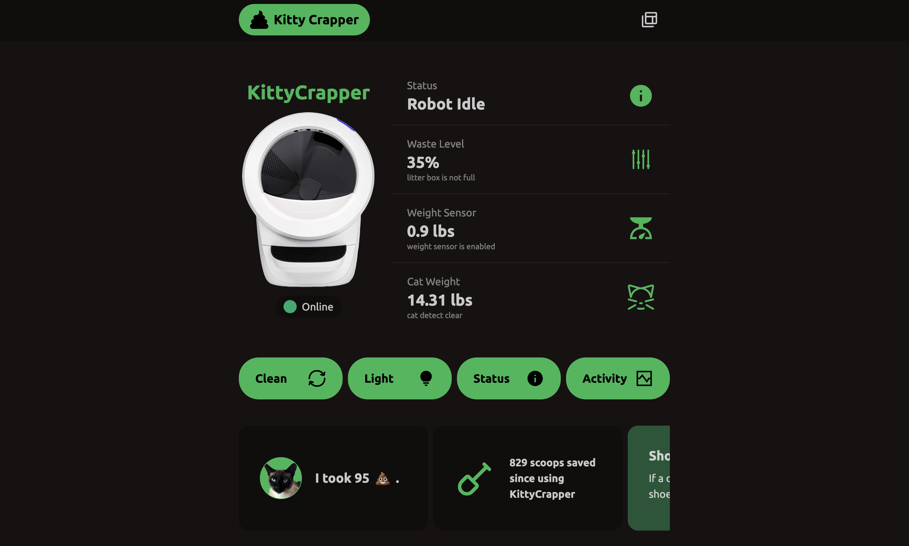

# multilitterrobot

Manage multiple Litter-Robots from one open-source web app — a full replacement for the Whisker app, built for households with more than one cat and more than one box.



## What it does

- **One dashboard for every box.** Live status, litter level, drawer level, WiFi signal, and firmware state per robot.
- **Per-cat tracking.** Each cat gets a profile (photo, color, input weight) and the app matches every visit to a cat by scale weight — with a settling gate so half-stepped-on readings don't log phantom visits.
- **Running average weight.** Kitty cards and graphs show each cat's running average weight (input weight + every automatic scale reading), not just the configured number. An **Average Weight tab** graphs the 7-day trailing average per cat, so you can see trends instead of single readings.
- **Corrections count.** Fixing a visit's cat ("Correct it") keeps the visit automatic, so its real scale weight moves to the right cat's average instead of dropping out. Resolving an anomaly as a cat visit likewise logs it as an automatic visit with its recorded weight.
- **Visit history and graphs.** Every visit logged with time, box, weight, and matched cat. Filter by cat, by date, and by waste type (pee / poop, marked per visit).
- **Anomalies, not silent misses.** Unmatched arrivals, ambiguous weights, interruptions, back-to-back visits, refills, and auto-resets land in an Anomalies tab where you can assign them to a cat, mark a refill or maintenance, or dismiss them. Two cats on the scale at once is detected by pair-sum and logged as one event per cat.
- **Drawer-full estimate.** Each box shows roughly how many days until its waste drawer is full, calculated from its observed fill rate (needs at least 24 hours of level history).
- **Litter refills logged.** Marking an anomaly as a refill records it — weight added, box, and date — so refill history lives alongside visit history.
- **Full robot controls.** Clean, reset the drawer, wait time, panel lock, sleep mode, night light (mode + Low / Medium / High brightness), panel brightness, and firmware check / update — all from the robot's settings menu.
- **Box colors.** Give each physical box a color (black, white, and six more). It shows as the card's left border and as the ring around that box's dots on the graph.
- **Prometheus metrics + Grafana dashboard.** A hand-rolled `/api/metrics` endpoint exposes everything worth graphing — visits, weights, drawer levels, anomalies, WiFi, cycles — with a Grafana dashboard to match.


## Screenshots

- `kitty-crapper.png` — the main dashboard (replace with your own screenshot; blur or remove any robot serials first).
- `grafana-dashboard.png` — the Grafana dashboard.

## Quick start

**Requirements:** Python 3.11, Node.js + pnpm, a Whisker account with your robots on it. Prometheus + Grafana are optional, for the metrics dashboard.

**Backend**

```bash
cd server
python -m venv venv
venv/bin/pip install -r requirements.txt
LITTERBOT_USERNAME=you@example.com LITTERBOT_PASSWORD=yourpassword venv/bin/python main.py
```

The API listens on `:4323`. For production, run it as a systemd service (see `litterbot.service` in this repo) — the service auto-restarts on failure.

**Frontend**

```bash
cd client
pnpm install
pnpm build
```

Serve `client/build` with nginx on `:80`, proxying `/api/*` to the backend on `:4323`. No nginx restart is needed after a rebuild — just hard-refresh the page.

**Prometheus**

Add a scrape job pointing at the app:

```yaml
- job_name: litterbot
  metrics_path: /api/metrics
  static_configs:
    - targets: ['your-host:80']
```

Then build the Grafana dashboard on top of it. See the metrics list below.

## Metrics exposed (`GET /api/metrics`)

| Metric | What it tells you |
|---|---|
| `litterbot_visits_total{pet,robot}` | Visits per cat, per box |
| `litterbot_visits_by_type_total{type}` | Visits by waste type (pee / poop) |
| `litterbot_last_visit_weight_lbs{pet,robot}` | Last recorded weight per cat, per box |
| `litterbot_last_visit_timestamp{pet,robot}` | When that last visit happened |
| `litterbot_seconds_since_last_visit{pet,robot}` | Time since each cat last went |
| `litterbot_pet_input_weight_lbs{pet}` | Configured weight per cat |
| `litterbot_pet_average_weight_lbs{pet}` | Running average weight per cat |
| `litterbot_events_total{type,resolution}` | Anomaly events by type and resolution (`unresolved` = still open) |
| `litterbot_uptime_seconds` | Backend uptime |
| `litterbot_drawer_level_percent{robot}` | Waste drawer level per box |
| `litterbot_drawer_full{robot}` | Drawer-full flag per box |
| `litterbot_litter_low{robot}` | Low-litter flag per box |
| `litterbot_robot_online{robot}` | Online flag per box |
| `litterbot_robot_status{robot,status}` | Current status per box |
| `litterbot_scoops_saved_total{robot}` | Scoops saved per box |
| `litterbot_cycles_total{robot}` | Clean cycles per box |
| `litterbot_wifi_rssi_dbm{robot}` | WiFi signal per box |

Visit history in Prometheus only goes back to when scraping started — there is no backfill.

## Data & privacy

All data lives on your own host (pets, visits, events, settings, and photos in the `server/` directory). Nothing is sent anywhere except to Whisker's cloud for robot control, same as the official app. Never commit robot serials to the repo.

## Status

Backend 0.6.30. Actively developed and dogfooded daily on two Litter-Robot 4s and three cats. LR5 waste-type auto-detection is on the roadmap — it needs a real LR5's activity data to identify the waste-type key, so it is not wired up yet.

Derived from [engageintellect/litterbot](https://github.com/engageintellect/litterbot).
